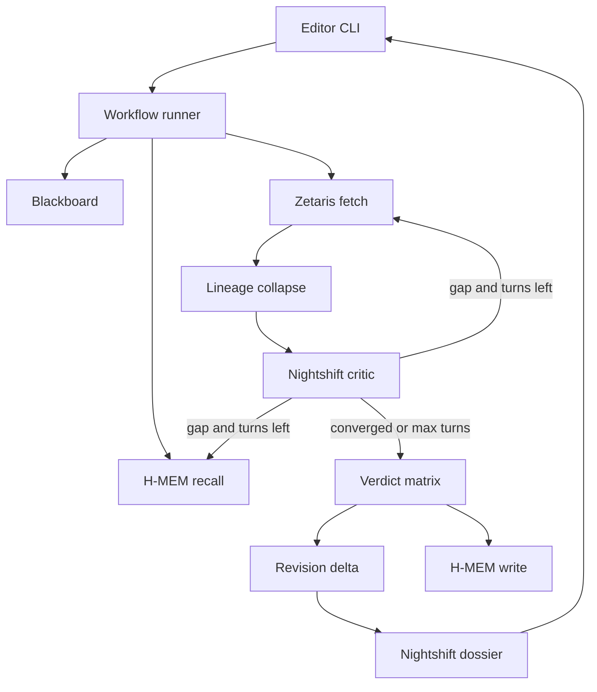

# False-claim desk

Implement the diagram as a CLI newsroom terminal under [build-oct26/desk](build-oct26/desk). Leave the research notebook ([build-oct26/notebook.ts](build-oct26/notebook.ts), [build-oct26/research-os](build-oct26/research-os)) in place. Reuse the vendored H-MEM facade in [build-oct26/vendor/hmem/src/index.ts](build-oct26/vendor/hmem/src/index.ts) the same way [build-oct26/research-os/src/memory/research-memory.ts](build-oct26/research-os/src/memory/research-memory.ts) does.

The product decision stays the one already specified in [docs/factchecker/4_cursor_plan_fake_news.md](docs/factchecker/4_cursor_plan_fake_news.md): a duty editor submits one caption plus an optional media id, and gets lineages, a rule verdict, an action badge, citations, and a revision line against the last check. The model writes criticism and the dossier. It does not pick the badge.

## Runtime shape

One in-process runner is the orchestration engine. It is not an overnight Nightshift queue. Each step is async, retried twice on a thrown error, and appended to a telemetry log on the blackboard: step name, attempt, duration, status. The blackboard holds the claim, recalled precedents, evidence rows, lineages, critic turns, the rule verdict, the revision delta, and the dossier.

## Contracts

Shared types in `build-oct26/desk/src/types.ts`.

- **Claim:** `id`, caption text, `claimedEventId`, optional `mediaId` or media URL. Event ids stay labels in the evidence table (`jodhpur-2016`, `conflict-2019`). Version 1 does not infer the event from free text.
- **Evidence row:** `id`, `claimId`, `text`, `publishedAt`, `eventId`, `originId`, `kind` (`archive` | `wire` | `repost`), `url`, `imageMatch`.
- **Critic turn:** `status` of `converged`, `contradiction`, or `missing_wire`; gap hints limited to a keyword, an `eventId`, or an `originId`; cited row ids. Unknown ids are dropped before the next step.
- **Verdict:** the rule table from the SameStory spec, in that order: `INSUFFICIENT` / Hold, `MISLEADING_CONTEXT` / do not publish, `DISPUTED` / Hold, `SUPPORTED` / Publish, else `INSUFFICIENT` / Hold.
- **Delta:** `UNCHANGED` or `REVISE` plus the previous verdict and action. Computed by comparing the new rule result with the H-MEM record loaded at the start of the run.
- **Dossier:** claim, lineages with copy counts, event groups, verdict and action badge, prior-decision line, explanation paragraph. Cited ids must appear in the retrieved lineage list.

## Three adapters

**Zetaris** (`desk/src/zetaris.ts`). One query function. When `ZETARIS_API_KEY` and `ZETARIS_ORG_ID` are set, POST parameterized SQL to the UI proxy already described in [docs/connect-researchos-to-zetaris.md](docs/connect-researchos-to-zetaris.md): `POST {ZETARIS_BASE_URL}/api/proxy/sql-editor/sqls/run-query` with the API key and org id. Initial fetch is `WHERE claim_id = ?`. A critic gap adds one extra predicate (keyword on `text`, or `event_id`, or `origin_id`). The critic never sends raw SQL. If Zetaris is unset or the call fails, read the same columns from `desk/fixtures/evidence.json` and label the source `fixture` in telemetry. Ship the aircraft corpus in that file: 2016 Jodhpur wire/archive with `imageMatch`, copy-only 2019 shootdown reposts sharing one `originId`, plus a supported claim and a thin claim. A disputed case is the aircraft rows plus a second independent wire on the claimed event.

**H-MEM** (`desk/src/memory.ts`). Persist under `build-oct26/desk/.memory`. On ingest, `hmem.query(caption)` and keep records tagged `desk:verdict` or `desk:precedent`. After the matrix, `hmem.add` the new verdict, action, origin ids, and time, tagged `desk:verdict` and `desk:claim:<id>`, with provenance refs set to the cited origin ids. Precedents are prior verdicts whose caption retrieval score clears a small threshold, plus the exact prior record for the same claim id. Editorial stance is that stored action, not a separate model. The revision delta is a pure compare of the loaded prior verdict and the new one, written before the new record is saved.

**Nightshift** (`desk/src/nightshift.ts`). OpenAI-compatible chat on the Meterless runtime, default `http://127.0.0.1:8088/v1`, bearer token from `METERLESS_RUNTIME_TOKEN`, header `meterless-app: samestory`. Three prompts, all required to return JSON:

- Evidence critic: given claim, lineages, and precedents, return the critic-turn schema. Status `contradiction` or `missing_wire` continues the loop.
- Semantic search hint: only used if the critic names a gap; it may narrow the hint, and it may not invent row ids.
- Dossier synthesizer: sees the claim, lineages, the verdict the rules already chose, and the delta. It writes the paragraph only.

Model id comes from `NIGHTSHIFT_MODEL` (default `meterless/deep`, which is how a local Nemotron route is selected when the runtime has one). Parse failure or HTTP failure retries inside the step, then the loop records `explanation unavailable` and still prints lineages, verdict, and badge. A citation filter removes any id that was not retrieved.

Cap the critic loop at 3 turns. Stop early when status is `converged`.

## Loop

`desk/src/workflow.ts` runs the steps in diagram order:

1. Ingest the claim and recall H-MEM.
2. Initial evidence fetch.
3. Collapse rows that share `originId` into one lineage. A lineage of only `repost` rows is copy-only and its earliest row stands in as the origin. Group lineages by `eventId`. The photo event is the `eventId` of the earliest archive or wire lineage with `imageMatch`. No image match means the report says image provenance is absent and judges text lineages only.
4. Critic. On `contradiction` or `missing_wire` and turns remaining, run the targeted Zetaris fetch and the H-MEM precedent query, merge new rows into the blackboard, collapse again, and repeat.
5. Apply the verdict matrix to the final lineages.
6. Compute the revision delta against the prior loaded in step 1, then store the new verdict.
7. Synthesize the dossier and filter citations.

`npx tsx desk/desk.ts check --id aircraft-2019 --caption "..." --event conflict-2019 --media jodhpur-photo` prints the dossier and the step telemetry. `check` with no flags runs the scripted demo: misleading claim, the same claim again (expect `REVISE` if a seeded prior said publish, else `UNCHANGED` on a third identical run), supported claim, insufficient claim.

## Tests

Node test script `desk/test/desk.test.ts`, no network:

- Aircraft fixture yields two lineages, `MISLEADING_CONTEXT`, and a do-not-publish badge. Reposts raise the copy count and do not add a lineage.
- Supported fixture yields `SUPPORTED` and cites only origin ids.
- Thin fixture yields `INSUFFICIENT` and Hold.
- A seeded prior with a different verdict yields `REVISE` and the previous action.
- A planted unknown citation id is absent from the dossier.
- With the Nightshift client forced to fail, the verdict and badge still print.

## What this leaves out

No live crawler and no live reverse-image call. Media provenance is the `imageMatch` column already in the evidence table. No free-form SQL from the model. The research notebook’s paper corpus is not the evidence store.