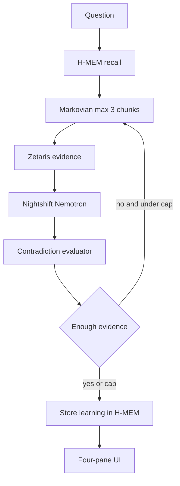

# ResearchOS phases 16–20

Baseline is the phase-15 agent in [build-oct26/research-os/src/agents/research-agent.ts](build-oct26/research-os/src/agents/research-agent.ts): H-MEM recall, one Zetaris query (`findPostQuantumAnonymousTraceableSchemes`), one reasoner call, then store the conclusion. Reasoning is the OpenAI SDK in [build-oct26/research-os/src/reasoning/llm-reasoner.ts](build-oct26/research-os/src/reasoning/llm-reasoner.ts) (`LLM_PROVIDER=openai`, model `gpt-4.1`). Deterministic reasoning stays for offline tests.

Do the provider swap first. Phases 16–19 call that same reasoner. Phase 20 only renders the result.



## 0. Power rule: Meterless Nightshift is the primary provider

Participant guide section 4.1 is not a second API. It says to implement the live prompt **POWER → Add Meterless as a provider** from [meterless.ai/engines.html](https://meterless.ai/engines.html). That prompt is the contract. Pasting it does not satisfy the Build rule. H-MEM is already the required engine, and Markovian is phase 18.

The app never holds an NVIDIA key and never sends `gpt-4.1` or `nvidia/nemotron-*`. It sends a `meterless/*` routing mode. Nightshift owns the NVIDIA key and the lane that pins Nemotron.

### Nightshift setup, before the code change

1. Install the Windows Nightshift app from [meterless.ai](https://meterless.ai). Use the installed Runtime, not the browser demo. Leave it running.
2. At [build.nvidia.com/models](https://build.nvidia.com/models), copy an NVIDIA API key for a Nemotron model with an API endpoint. In Nightshift, open Setup, then Providers, select NVIDIA, and save that key there. Do not put it in `research-os/.env`.
3. Open the NIGHT tab, then LANES. Put Nemotron on at least one active lane. The guide's examples are `nvidia/nemotron-3.5-lightning-30b-a3b` for the fast lane and `nvidia/nemotron-3.5-super-vl-120b-a12b` for the deep lane. Use the exact names Nightshift lists. `meterless/auto` can pick a non-NVIDIA model when several lanes are eligible, so the award evidence is a lane that is Nemotron.
4. Open Console at the top right. Copy the Runtime base URL and the Runtime access token. These are not the NVIDIA key. Default shape:

```
METERLESS_BASE_URL=http://127.0.0.1:8088/v1
METERLESS_RUNTIME_TOKEN=<console token>
METERLESS_MODEL=meterless/auto
```

`http://127.0.0.1:8088/v1` is only the same-machine example. A connect link `http://<host>:<port>/connect#k=<token>` means base URL `origin + /v1` and token `k`. Reject an empty token and the placeholder `rt-local`. Do not log the token.

### What the reasoner implements

Replace the OpenAI client in [build-oct26/research-os/src/reasoning/llm-reasoner.ts](build-oct26/research-os/src/reasoning/llm-reasoner.ts). `LLM_PROVIDER=meterless` is the primary path. Keep the deterministic reasoner for offline tests. Remove `OPENAI_API_KEY`, `OPENAI_MODEL`, and the `openai` package from this ResearchOS path. Leave [build-oct26/src/llm.ts](build-oct26/src/llm.ts) alone.

Provider behavior from the Power Prompt:

- Provider id `meterless`. Default base URL `http://127.0.0.1:8088/v1`. Normalize a pasted URL that includes `/v1/chat/completions`, `/v1/models`, or `/healthz` to `<origin>/v1`. Never produce `/v1/v1`.
- Every call sends `Authorization: Bearer <METERLESS_RUNTIME_TOKEN>`, `meterless-app: research-os`, and `meterless-scope: user`.
- Model ids are routing modes read from `GET /v1/models`: `meterless/auto`, `meterless/fast`, `meterless/deep`, `meterless/cheap`, `meterless/local`, `meterless/fusion`, plus `meterless/<class>` and `meterless/<class>.<disposition>`. Keep an unknown `meterless/*` id. `METERLESS_MODEL` overrides the default `meterless/auto`.
- `GET /healthz` only means the process is up. `GET /v1/models` decides status: `401` or `403` is unauthorized, `200` with `meterless/*` ids is online, anything else is offline. Auto-detect tries ports `8088`, `8090`, `8787`, and `11434` on `127.0.0.1`.
- Chat is `POST /v1/chat/completions` with `fetch`. Timeout 180s. Save the response `model` field on the conclusion trace so the UI and the Nightshift receipt can show which model answered.
- Keep `parseConclusion`. If Nightshift returns 400 for `response_format: json_schema`, retry once without it and still validate. Do not accept unvalidated text.

Write the three keys into [build-oct26/research-os/.env](build-oct26/research-os/.env) and the same keys, empty, into [build-oct26/research-os/.env-example](build-oct26/research-os/.env-example).

Checkpoint, matching guide section 4.6: one sentence through `meterless/auto` succeeds, a wrong token is unauthorized rather than offline, and `npx tsx research-os/test-llm-reasoner.ts` returns an assessment whose source ids are a subset of the valid ids. Confirm in Nightshift's run details that the lane model is Nemotron.

## 16. Contradiction evaluator

Add [build-oct26/research-os/src/agents/evaluator.ts](build-oct26/research-os/src/agents/evaluator.ts). Input is the research context plus the conclusion. Output is one record per prior memory that the evidence touches:

- `relationship`: `SUPPORTS`, `CONTRADICTS`, `EXTENDS`, or `UNRELATED`
- `memoryId`, `evidence` (source ids only), `confidence` (0–1), `reason`, `recommendation`
- `CONTRADICTS` recommends `Revise existing conclusion.` Other relationships get a one-line recommendation.

One Nemotron call, same validation rules as the reasoner. When `RESEARCH_REASONER` is not `llm`, use a deterministic pairing: a memory that says a trusted opener is required, against Zetaris rows with `trusted_opener_required: false` or a skeptical note, is `CONTRADICTS`. Anything else with overlapping source ids is `SUPPORTS` or `EXTENDS`; no overlap is `UNRELATED`.

Call it from `ResearchAgent` after `assess`. Add the reports to `ResearchAgentResult` and print the contradiction block from [build-oct26/research-os/research.ts](build-oct26/research-os/research.ts).

## 17. Iterative research, capped at 3

Replace the single gather-and-assess pass with a loop owned by the agent, max 3 iterations.

Each iteration:

1. Read what is still open (first pass: the question; later passes: `openQuestions` and `REMAINING`).
2. Recall H-MEM for that text.
3. Query only the Zetaris method that matches: `getPaperEvidence` when a known paper id is named, `getPotentiallyConflictingEvidence` when the open point is a conflict, otherwise `findPostQuantumAnonymousTraceableSchemes`.
4. Assess with the reasoner. Stop when assessment is not `INSUFFICIENT` and `openQuestions` is empty, or the cap is hit.

Record a trace entry per iteration: `Search memory`, `Query Zetaris`, `Found conflict` or `No conflict`, `Investigate`, `Conclusion`. Keep the existing duplicate-finding check before writing H-MEM. Add iteration count and trace to the result and the CLI timings.

## 18. Vendor Markovian and prove cold versus warm

The workspace is the starter, not the Meterless root. Vendor the engine the same way H-MEM is vendored:

`npx --yes degit meterless/meterless/engines/markovian/reference research-os/vendor/markovian`

Add [build-oct26/research-os/test-markovian.ts](build-oct26/research-os/test-markovian.ts). It imports `Markovian` from that vendor and runs the same short research goal twice with a deterministic generator (no network): cold with no `memoryContext`, warm with an H-MEM reinjection string that already settles one step. The generator emits `[STATE_CHECKPOINT]` with `COMPLETED`, `REMAINING`, `DECISIONS`, `CONTEXT`, then `[TASK_COMPLETE]`. Assert the warm run uses fewer chunks. Config must respect engine bounds: `chunkSize` at least 1000, `maxChunks` 3, `carryoverTokens` at least 128, `reflect: false`.

## 19. Carry research state with Markovian

Fold the phase-17 loop into Markovian instead of keeping a second loop.

- `goal` is the research question. `mode` is `RESEARCH`. `memoryContext` is the H-MEM reinjection text on the warm path and omitted on the cold path.
- `stepFn` performs one phase-17 iteration and returns checkpoint text. Markovian carries `COMPLETED`, `REMAINING`, `DECISIONS`, and `CONTEXT` into the next prompt. `maxChunks: 3` is the cap.
- The Nemotron call sees the current chunk prompt, not the full history.
- Add `research-compare "<question>"` to [build-oct26/research-os/research.ts](build-oct26/research-os/research.ts). It runs cold then warm and prints chunk count, status, and which steps the warm run marked already resolved. The normal `research` command is the warm path and stores the final conclusion in H-MEM once.

## 20. Four-pane UI

No React and no new UI dependencies. Add [build-oct26/research-os/ui/server.ts](build-oct26/research-os/ui/server.ts) (`node:http`) and [build-oct26/research-os/ui/index.html](build-oct26/research-os/ui/index.html).

- `POST /api/research` with `{ "question": "..." }` runs the warm agent and returns the JSON result. Static files are served from `ui/`.
- Layout matches the design: question, research memory (claim versus contradiction), Zetaris evidence with paper ids, agent trace with Markovian chunk status. Label each pane with its source: H-MEM, Zetaris, Markovian, Nemotron.
- Empty question shows a validation message. Agent errors show the existing safe error string, not a stack trace.
- Script: `npx tsx research-os/ui/server.ts`. Verify in the browser: submit the trusted-opener question, confirm memory, evidence, a contradiction, and a trace that ends in a conclusion.

## Checks

- Deterministic path still runs with Zetaris up and Nightshift down: `RESEARCH_REASONER=deterministic`.
- LLM path uses `meterless/auto`, rejects a bad token as unauthorized, rejects invented source ids, and Nightshift shows a Nemotron lane model.
- Warm Markovian run finishes in at most 3 chunks and stores at most one new H-MEM finding.
- UI submit shows all four panes for that same question.
