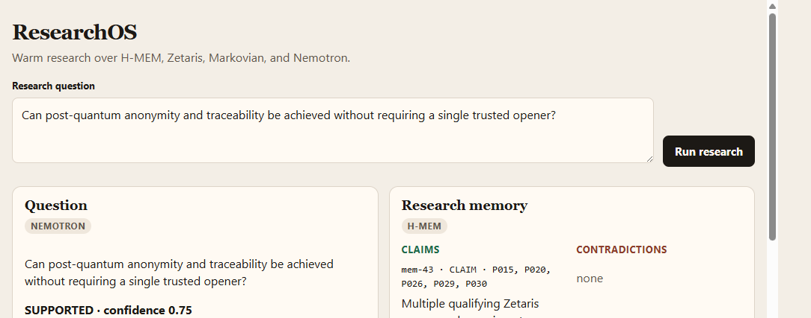
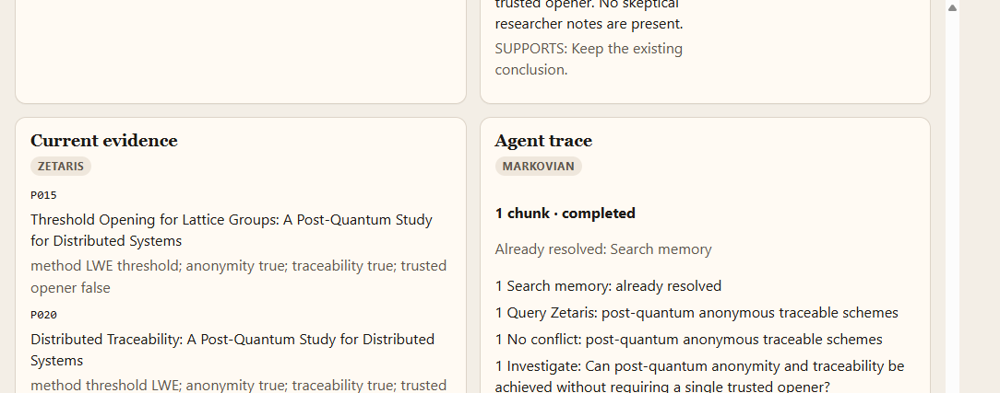
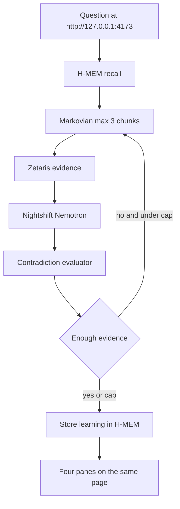

# ResearchOS

Open the UI at **[http://127.0.0.1:4173](http://127.0.0.1:4173)**.

From `build-oct26`:

```bash
npx tsx research-os/ui/server.ts
```

Then open that address. Press **Run research**. The screenshots below are that page after the trusted-opener question. The conclusion is **SUPPORTED**. The contradictions column is empty because the stored memories already agree with the papers. The trace says Search memory was already resolved because this is a warm run.

The top of the page is the question, the Nemotron conclusion, and the H-MEM claims:



Scroll down for the Zetaris papers and the Markovian trace:



## Sponsor technologies
Cursor IDE was used for developing this application. Zetaris supplies the current papers, notes, and experiments. H-MEM and Markovian are the Meterless reference engines vendored in this folder. They were not rewritten for this project. Nightshift is the only model call. The NVIDIA key stays in Nightshift Providers and is not stored in this repo. ResearchOS calls the local runtime at `http://127.0.0.1:8088/v1` with the runtime token and `METERLESS_MODEL=nvidia/nemotron-3.5-lightning-30b-a3b`.

On a warm run, H-MEM (`vendor/hmem`, persisted in `.memory`) recalls prior findings and that text is injected into the first Markovian chunk. Markovian (`vendor/markovian`) then carries the work forward in at most 3 chunks. Each chunk asks Zetaris for evidence that is not already completed, and Nemotron assesses that chunk through Nightshift.

Two commands show that this path works. Run both from `build-oct26`.

Markovian, with Nightshift stopped:

```bash
npx tsx research-os/test-markovian.ts
```

The cold run finishes in 3 chunks. The warm run is given an H-MEM reinjection that already settled one step, so it finishes in 2. The script prints `pass` when that holds.

One real Nightshift request, with the runtime up and Zetaris up:

```bash
npx tsx research-os/test-llm-reasoner.ts
```

It prints an assessment, a summary, a confidence, supporting and conflicting source ids, and the valid source ids from the evidence that was sent. The supporting and conflicting ids are a subset of that valid list.

The submission deck is [slides.html](slides.html). The recording script is [DEMO-SCRIPT.md](DEMO-SCRIPT.md).

## How the page works

Pressing **Run research** sends the question to `POST /api/research`. The server runs the warm agent and fills the four panes:

| Pane on the page | Source label | What the screenshot is showing |
|---|---|---|
| Question | Nemotron | The question, **SUPPORTED**, confidence 0.75, and supporting papers P015, P020, P026, P029, P030 |
| Research memory | H-MEM | Claims on the left, each marked SUPPORTS. Contradictions on the right, currently none |
| Current evidence | Zetaris | One block per paper id, including method, anonymity, traceability, and trusted opener false |
| Agent trace | Markovian | `1 chunk · completed`, Search memory already resolved, then Query Zetaris, No conflict, Investigate, and Conclusion |

A blank question stays on the page and shows `Research question cannot be empty`. It does not call the agent.

Behind that button, one warm run does this:

1. H-MEM recalls prior findings and that text is injected into the first Markovian chunk. Search memory is not repeated.
2. Markovian runs at most 3 chunks. Each chunk queries Zetaris once for something not already completed.
3. Nemotron, or the deterministic reasoner when Nightshift is off, assesses only the current chunk plus the evidence gathered so far.
4. The contradiction check compares each memory with the Zetaris papers.
5. The conclusion is stored in H-MEM once, unless that same finding is already there.
6. The four panes render that result. The trace ends in a conclusion.

## Architecture



| Piece | Role | Where it lives |
|---|---|---|
| H-MEM | Prior claims, contradictions, and the reinjection text for a warm run | `vendor/hmem`, persisted in `.memory` |
| Markovian | Carries `COMPLETED`, `REMAINING`, `DECISIONS`, and `CONTEXT` from one chunk to the next | `vendor/markovian` |
| Zetaris | Current papers, notes, and experiments | `src/zetaris` |
| Nemotron | Assessment and contradiction check, through Nightshift | `src/reasoning/llm-reasoner.ts` |
| Deterministic reasoner | Same decisions offline, with Nightshift down | `src/reasoning/deterministic-reasoner.ts` |
| UI | The four panes at http://127.0.0.1:4173 | `ui/server.ts`, `ui/index.html` |

## How the loop works

`research` and the UI both run the warm path. `research-compare` runs the same question cold, then warm.

### Warm and cold

On a warm run, ResearchOS recalls H-MEM for the question before the first chunk and passes that reinjection in as Markovian `memoryContext`. Chunk 1 already contains `[MEMORY CONTEXT]`, so **Search memory** is marked already resolved and is not queried again. A cold run omits `memoryContext`. Its first chunk searches H-MEM itself.

Later chunks do not see the original reinjection. They search H-MEM for whatever is still open.

### One chunk

Markovian calls a `stepFn` once per chunk, at most three times. `mode` is `RESEARCH`. `reflect` is off. The chunk config is `chunkSize` 2000, `maxChunks` 3, and `carryoverTokens` 128.

Each chunk does one research pass:

1. **Search memory** for the current focus. The first focus is the question. Later, the focus is the open questions carried in `REMAINING`.
2. **Query Zetaris** once, and only for a query that has not already been recorded in `COMPLETED`:
   - `getPaperEvidence` when the focus names a paper id such as `P015` and the scheme search has already run, or when the focus itself names that paper.
   - `getPotentiallyConflictingEvidence` when the focus is about a conflict, contradiction, or skeptical note.
   - Otherwise `findPostQuantumAnonymousTraceableSchemes`, once.
3. **Assess** the accumulated papers, notes, and experiments. The reasoner sees this chunk's prompt, including the carryover state, plus the memories and evidence gathered so far. It does not see the raw text of earlier chunks.
4. **Conclusion.** The chunk ends with `[STATE_CHECKPOINT]` and the four state lines. The last chunk also ends with `[TASK_COMPLETE]`.

The loop stops when the assessment is not `INSUFFICIENT` and there are no open questions, when no further Zetaris query exists, or at chunk 3.

### Assessment

The reasoner must return `SUPPORTED`, `CONTRADICTED`, `MIXED`, or `INSUFFICIENT`, a summary, a confidence from 0 to 1, source ids, and open questions. Every source id has to appear in the supplied memories or evidence. Invented ids are rejected.

`RESEARCH_REASONER=llm` sends that request to Nightshift. The NVIDIA key stays in Nightshift. ResearchOS sends the runtime token and the model id in `METERLESS_MODEL`. With thinking disabled, Nemotron returns the structured conclusion. If the structured call fails, the client retries, then asks for a JSON object, and can still read a labeled `assessment` / `confidence` / `reasoning` answer.

`RESEARCH_REASONER=deterministic` applies fixed rules for the post-quantum anonymity and traceability question. Qualifying papers with anonymity, traceability, no trusted opener, and a passing experiment are `SUPPORTED` at confidence 0.75. A skeptical note or a failed experiment against that support is `MIXED` or `CONTRADICTED`. Any other question is `INSUFFICIENT`. This path does not call Nightshift.

### Contradiction check

After the last chunk, one evaluation compares each retrieved memory with the Zetaris evidence:

| Relationship | Meaning | Recommendation |
|---|---|---|
| `SUPPORTS` | The memory and the evidence cite the same sources and do not conflict | Keep the existing conclusion. |
| `EXTENDS` | The evidence adds sources the memory did not cite | Add the new evidence to the existing conclusion. |
| `CONTRADICTS` | The memory says a trusted opener is required, and the evidence records traceability without one, or a skeptical note | Revise existing conclusion. |
| `UNRELATED` | No shared source ids | Leave the existing conclusion unchanged. |

The LLM path asks Nemotron for these reports and checks the ids. A missing memory is filled with the deterministic report. `CONTRADICTS` always uses the recommendation above.

### What gets stored

The warm `research` command, and the UI, store the final summary in H-MEM once. A second run with the same summary and the same source ids finds the existing record and does not write another one. `INSUFFICIENT` is stored as an open question, `SUPPORTED` as a claim, `MIXED` as a limitation, and `CONTRADICTED` as a contradiction. `research-compare` does not store.

## Setup

Commands below are run from `build-oct26`.

### 1. Install

You need Node.js 20 or newer. From `build-oct26`:

```bash
npm install
```

H-MEM and Markovian are already vendored under `research-os/vendor`. They have no runtime dependencies. Do not put an NVIDIA key in this repo.

### 2. Configure

```bash
cp research-os/.env-example research-os/.env
```

On Windows PowerShell, `Copy-Item research-os/.env-example research-os/.env`. Fill in local values. `.env` is gitignored.

```
ZETARIS_BASE_URL=http://127.0.0.1:3000
ZETARIS_ORG_ID=
ZETARIS_USERNAME=
ZETARIS_PASSWORD=
ZETARIS_API_KEY=
LLM_PROVIDER=meterless
RESEARCH_REASONER=llm

METERLESS_BASE_URL=http://127.0.0.1:8088/v1
METERLESS_RUNTIME_TOKEN=
METERLESS_MODEL=nvidia/nemotron-3.5-lightning-30b-a3b
```

Zetaris must be running at `ZETARIS_BASE_URL` with the org id and either a username and password or an API key. The papers used by the demo question include `P015`, `P020`, `P026`, `P029`, and `P030`.

Nightshift setup:

1. Install Nightshift from [meterless.ai](https://meterless.ai) and leave the runtime running. `GET /healthz` only means the process is up. `GET /v1/models` is the real check.
2. Create an NVIDIA key at [build.nvidia.com](https://build.nvidia.com) and save it in Nightshift under Setup, then Providers, then NVIDIA. Do not copy that key into `.env`.
3. In Nightshift, open NIGHT, then LANES, and put Nemotron on an active lane. This project pins `nvidia/nemotron-3.5-lightning-30b-a3b`. `meterless/auto` can route to a different model, so leave `METERLESS_MODEL` set to the NVIDIA id that `GET /v1/models` lists.
4. In the Nightshift console, copy the runtime base URL and the runtime token. A connect link `http://<host>:<port>/connect#k=<token>` means base URL `origin + /v1` and token `k`. Reject an empty token and the placeholder `rt-local`.

`LLM_PROVIDER` must be `meterless`. Set `RESEARCH_REASONER=deterministic` when you want the offline rules and Nightshift can be stopped. An environment variable already set in the shell wins over `.env`.

### 3. Seed memory

```bash
npx tsx research-os/research.ts seed-memory
```

This loads the local research notes into `.memory`. Later research conclusions are stored in the same directory and survive a restart.

### 4. Start the UI

```bash
npx tsx research-os/ui/server.ts
```

Open [http://127.0.0.1:4173](http://127.0.0.1:4173). The port is `RESEARCH_UI_PORT` when that variable is set.

Check the page and a full research response:

```bash
npx tsx research-os/test-ui.ts
```

`test-ui.ts` expects the server to be running. It checks the four pane labels, the empty-question error, paper ids, a trace that ends in a conclusion, and a Markovian run of 1 to 3 chunks. With `RESEARCH_REASONER=llm` this call waits on Nemotron, up to three minutes.

## User guide

The page walkthrough, with screenshots of the question box and each pane, is in [USER-GUIDE.md](USER-GUIDE.md). The only input on the page is the **Research question** box. Press **Run research** and read Question (Nemotron), Research memory (H-MEM), Current evidence (Zetaris), and Agent trace (Markovian).

### Ask from the terminal

```bash
npx tsx research-os/research.ts research "Can post-quantum anonymity and traceability be achieved without requiring a single trusted opener?"
```

This is the same warm path as the UI. It prints the memories, the papers, the assessment, the contradiction block, whether a memory was stored, the iteration count, the Markovian chunk status, and the trace.

Compare a run with no prior reinjection to a warm run:

```bash
npx tsx research-os/research.ts research-compare "Can post-quantum anonymity and traceability be achieved without requiring a single trusted opener?"
```

Cold has nothing already resolved. Warm lists **Search memory** under already resolved. Both stay within 3 chunks. This command does not store a new finding.

Other commands:

```bash
npx tsx research-os/research.ts search "traceability"
npx tsx research-os/research.ts evidence P015
npx tsx research-os/research.ts schemes
npx tsx research-os/research.ts evidence-conflicts
npx tsx research-os/research.ts memory "trusted opener"
npx tsx research-os/research.ts audit mem-35
```

`search` reads the local paper catalog. `evidence`, `schemes`, and `evidence-conflicts` query Zetaris. `memory` prints the H-MEM hits for a query. `audit` prints the trust-ledger history for one memory id.

### Tests

Run these from `build-oct26`. Zetaris needs to be up for every test except `test-markovian.ts`. Nightshift needs to be up, with a valid runtime token, for the two LLM tests.

```bash
npx tsx research-os/test-markovian.ts
npx tsx research-os/test-zetaris.ts
npx tsx research-os/test-memory.ts ask "trusted opener"
npx tsx research-os/test-research-agent.ts
npx tsx research-os/test-evaluator.ts
npx tsx research-os/test-llm-reasoner.ts
npx tsx research-os/test-ui.ts
```

`test-markovian.ts` uses a deterministic generator and no network. The cold run takes 3 chunks. The warm run is given an H-MEM reinjection that already settled one step, so it finishes in 2. `test-evaluator.ts` plants a belief that a trusted opener is still required and checks that both the deterministic evaluator and Nemotron mark it `CONTRADICTS` with the recommendation `Revise existing conclusion.`
