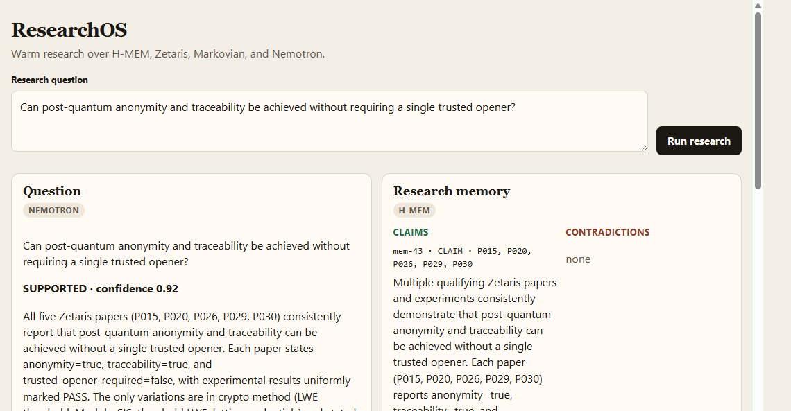
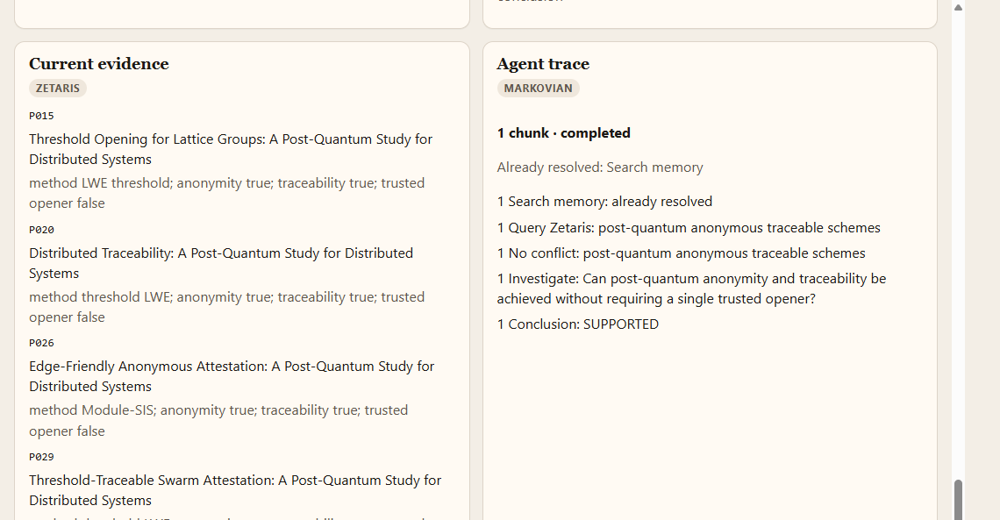

# ResearchOS user guide

Start the page from `build-oct26`:

```bash
npx tsx research-os/ui/server.ts
```

The terminal prints the address, normally [http://127.0.0.1:4173](http://127.0.0.1:4173). If that port is already taken, start it on another port and open the address it prints:

```bash
RESEARCH_UI_PORT=4180 npx tsx research-os/ui/server.ts
```

The screenshots below are that page at [http://127.0.0.1:4180](http://127.0.0.1:4180) after **Run research** finished. The only thing you type is the research question.

## What you type



The label above the box is **Research question**. The box already contains:

> Can post-quantum anonymity and traceability be achieved without requiring a single trusted opener?

You can keep that sentence or replace it with your own question. Write it as a question in plain language. You do not enter a paper id, a model name, or a login. Zetaris and Nightshift are configured in `.env` before the server starts.

Press **Run research**. The button changes to **Researching…** and stays that way until the run finishes. A Nemotron run often takes about a minute. Leave the page open.

A blank or whitespace-only box does not call the agent. The page shows `Research question cannot be empty`.

## What each section shows

The page has four panes. The badge under each title names the system that filled it.

### Question — Nemotron

This is the answer to the sentence you typed.

| Line | Meaning |
|---|---|
| The question | The text that was sent, repeated so you can check it |
| Assessment and confidence | One of `SUPPORTED`, `CONTRADICTED`, `MIXED`, or `INSUFFICIENT`, then a confidence from 0 to 1. The screenshot shows **SUPPORTED · confidence 0.92** |
| Summary | The reason for that assessment, in a short paragraph |
| Supporting | Paper ids the conclusion relies on. Here: P015, P020, P026, P029, P030 |
| Conflicting | Paper ids that argue the other way. **none** means Nemotron did not cite a conflicting paper |
| Open questions | What is still unanswered. **none** means this run will not fetch another round of evidence |

`INSUFFICIENT`, or a non-empty open-questions line, means the agent may take another chunk, up to three.

### Research memory — H-MEM

Prior findings that were recalled for this question. The pane is split in two.

**Claims**, on the left, are memories that do not conflict with the papers. Each card shows:

- memory id, such as `mem-43`
- label, such as `CLAIM`
- source ids, such as `P015, P020, P026, P029, P030`
- the stored sentence
- the relationship and recommendation, such as `SUPPORTS: Maintain existing conclusion`

**Contradictions**, on the right, are memories the evaluator marked `CONTRADICTS`. **none**, as in the screenshot, means every recalled memory agrees with the current papers. A contradiction would appear here with the recommendation to revise the existing conclusion.

### Current evidence — Zetaris



These are the papers fetched for this run. You do not pick them. Each card shows:

| Field | Meaning |
|---|---|
| Paper id | The Zetaris id, such as `P015` |
| Title | The paper title |
| method | The cryptographic method, such as `LWE threshold` |
| anonymity | Whether the paper reports anonymity |
| traceability | Whether the paper reports traceability |
| trusted opener | Whether a single trusted opener is required. `false` means it is not |

### Agent trace — Markovian

This is the path the agent took. You do not edit it.

| Line in the screenshot | Meaning |
|---|---|
| `1 chunk · completed` | One research pass finished, and the run stopped. A run uses at most 3 chunks |
| `Already resolved: Search memory` | Prior memory was already injected, so that search was not repeated |
| `Search memory: already resolved` | The memory step for this chunk |
| `Query Zetaris: post-quantum anonymous traceable schemes` | The evidence query that ran |
| `No conflict: …` | That query did not return a conflicting note. A conflict would read `Found conflict` |
| `Investigate: …` | The question that chunk assessed |
| `Conclusion: SUPPORTED` | The assessment that ended the run |

The last step is always a conclusion when the run succeeds.

## While you wait, and if it fails

The four panes stay on their previous text until the new result arrives. The button is the signal that a run is in progress.

| Message on the page | What to do |
|---|---|
| `Research question cannot be empty` | Type a question, then press **Run research** again |
| `ZETARIS_CONNECTION_ERROR` | Start Zetaris at the address in `.env` |
| `ZETARIS_AUTHENTICATION_ERROR` | Check the Zetaris username, password, or API key in `.env` |
| `REASONING_ERROR` | Nemotron answered, but the conclusion could not be accepted. Read the server terminal for the `[ResearchOS]` line |
| `EVALUATION_ERROR` | The contradiction check failed. Read the same terminal line |
| `MEMORY_RETRIEVAL_ERROR` | Nightshift is down, the runtime token was rejected, or another step failed before a conclusion |

The page shows that short message. It does not show a stack trace. The terminal where you started the server prints the step that was running, such as `Assessing evidence` or `Evaluating contradictions`.
